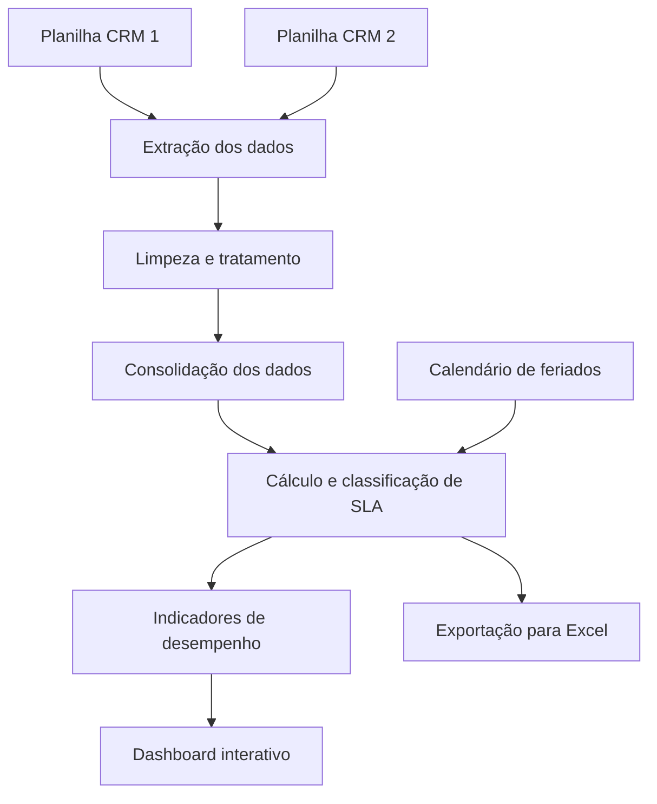

# Análise de SLA de Atendimento

Aplicação web desenvolvida em Python e Dash para automatizar a consolidação, o tratamento e a análise de dados de atendimento ao cliente provenientes do módulo CRM de um sistema corporativo de recebíveis.

A solução permite monitorar o cumprimento dos SLAs de atendimento, acompanhar indicadores de desempenho e explorar informações por empreendimento por meio de dashboards interativos e relatórios consolidados.

## Contexto e objetivo

O projeto foi desenvolvido para atender à necessidade da equipe de Relacionamento com o Cliente de acompanhar os prazos de atendimento e avaliar o desempenho operacional.

O processo de geração do relatório era realizado manualmente a partir de duas planilhas exportadas do sistema de recebíveis, demandando tempo para consolidação, tratamento dos dados e cálculo dos indicadores.

A aplicação automatizou essas etapas, centralizando o processamento e a visualização das informações em uma única interface.

## Resultados

| Indicador | Antes | Depois |
|---|---:|---:|
| Tempo de geração do relatório | 6 horas | 3 minutos |

**Redução de aproximadamente 99% no tempo de execução do processo.**

Além da redução do tempo operacional, a solução proporcionou:

- Padronização do processamento dos dados.
- Automatização dos cálculos de SLA.
- Centralização dos indicadores de desempenho.
- Redução da necessidade de manipulação manual de planilhas.
- Maior autonomia na exploração das informações.

## Funcionalidades

- Upload de duas planilhas Excel exportadas do módulo CRM.
- Consolidação automática das fontes de dados.
- Limpeza, tratamento e transformação de dados.
- Classificação dos chamados por SLA de 48 e 72 horas.
- Cálculo automatizado dos prazos de atendimento.
- Consideração de finais de semana e feriados nacionais.
- Visualização de indicadores de desempenho.
- Dashboard interativo com gráficos e filtros.
- Segmentação das informações por empreendimento.
- Exportação do relatório consolidado para Excel.
- Interface web responsiva.

## Interface da aplicação

### Página inicial e indicadores


### Geração do relatório consolidado


### Dashboard de desempenho — Parte 1


### Dashboard de desempenho — Parte 2


## Fluxo de dados

A aplicação utiliza duas planilhas exportadas do módulo CRM do sistema de recebíveis como fontes de dados.

O processamento contempla a consolidação das informações, a aplicação das regras de negócio, o cálculo dos prazos de atendimento e a disponibilização dos resultados.



## Regras de negócio

O cálculo dos indicadores considera os prazos de atendimento definidos pela operação.

| Regra | Descrição |
|---|---|
| SLA 48h | Classificação dos chamados com prazo de atendimento de 48 horas. |
| SLA 72h | Classificação dos chamados com prazo de atendimento de 72 horas. |
| Calendário | Consideração de finais de semana e feriados nacionais no cálculo dos prazos. |
| Empreendimento | Segmentação dos chamados e indicadores por empreendimento. |

As regras foram implementadas em Python, permitindo a automatização e padronização dos cálculos.

## Tecnologias utilizadas

| Tecnologia | Finalidade |
|---|---|
| Python | Desenvolvimento e processamento de dados |
| Pandas | Limpeza, transformação e consolidação dos dados |
| NumPy | Operações auxiliares e cálculo de datas úteis |
| Dash | Desenvolvimento da aplicação web |
| Plotly | Criação de gráficos e visualizações interativas |
| Dash Bootstrap Components | Componentes visuais e responsividade |
| XlsxWriter | Geração e exportação de relatórios Excel |
| datetime | Manipulação de datas e cálculo de prazos |
| CSS | Estilização da interface |

## Estrutura do projeto

```text
.
├── app.py
├── callbacks.py
├── dashboard.py
├── dashboard_callbacks.py
├── feriados.py
├── layout.py
├── requirements.txt
├── custom.css
└── assets/
    └── images/
        ├── img_1.png
        ├── img_2.png
        ├── img_3.png
        └── img_4.png
```

## Como utilizar

1. Acesse a interface da aplicação.
2. Realize o upload das duas planilhas exportadas do módulo CRM.
3. Execute o processamento dos dados.
4. Consulte os indicadores de desempenho e cumprimento dos SLAs.
5. Utilize os filtros para explorar as informações por empreendimento.
6. Exporte o relatório consolidado para Excel.

## Como executar

### 1. Clonar o repositório

```bash
git clone https://github.com/paesdj1987/analise-sla-atendimento.git
cd analise-sla-atendimento
```

### 2. Criar um ambiente virtual

```bash
python -m venv .venv
```

Ativação no Windows:

```bash
.venv\Scripts\activate
```

Ativação no Linux/macOS:

```bash
source .venv/bin/activate
```

### 3. Instalar as dependências

```bash
pip install -r requirements.txt
```

### 4. Executar a aplicação

```bash
python app.py
```

## Competências aplicadas

- Análise de dados.
- Business Intelligence.
- Automação de processos.
- Extração, transformação e consolidação de dados.
- Limpeza e qualidade de dados.
- Implementação de regras de negócio.
- Monitoramento de indicadores de desempenho.
- Análise de SLA.
- Desenvolvimento de dashboards interativos.
- Desenvolvimento de aplicações web orientadas a dados.
- Automação de relatórios gerenciais.

## Observações

A aplicação foi desenvolvida para processar arquivos com a estrutura específica dos relatórios exportados pelo sistema corporativo de recebíveis.

A utilização de arquivos provenientes de outros sistemas pode exigir adaptações nas regras de processamento.

## Autor

**João Paes**

- [GitHub](https://github.com/paesdj1987)
- [LinkedIn](https://www.linkedin.com/in/joao-paes87)
- [Portfólio](https://joao-paes.vercel.app/)
